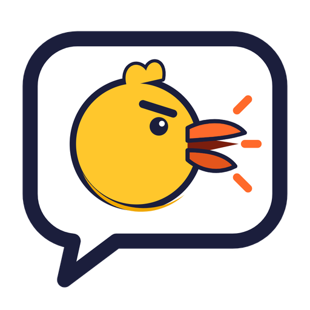
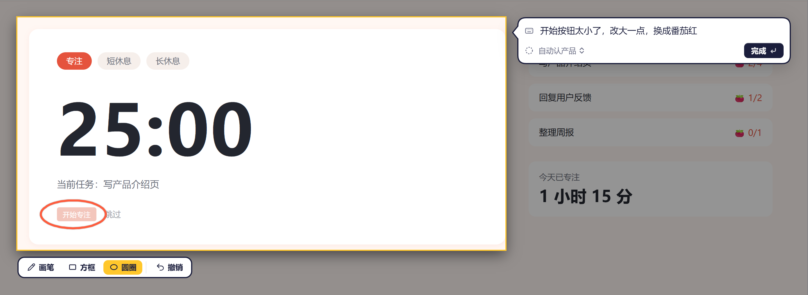
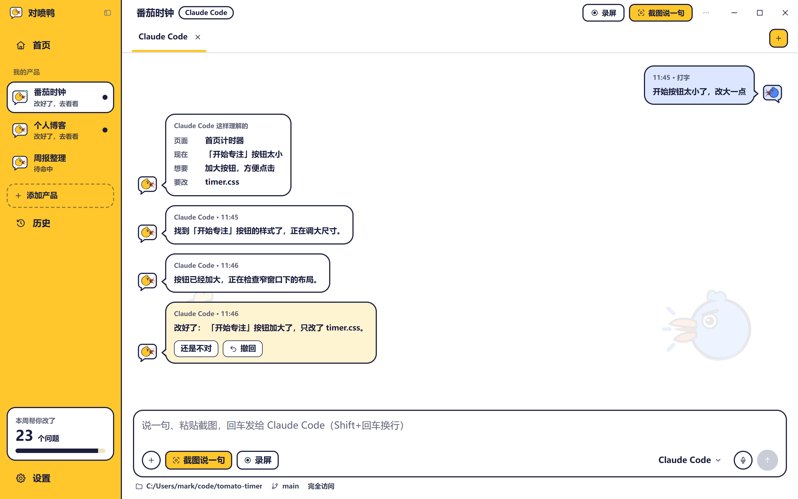
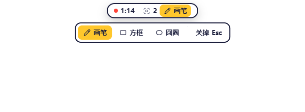

  

<h1 align="center">对喷鸭 Quack</h1>

<b>指着问题说一句，AI 直接改掉。</b>

  <a href="https://github.com/Aimark-dai/quack/releases/latest"><b>⬇ 下载 Windows 版</b></a>

---

用 Claude Code、Codex 做产品，最费时间的往往不是改，而是**说清楚哪里要改**：截图、存文件、切窗口、打一大段字解释「哪个页面、哪个按钮、现在什么样、想要什么样」。

对喷鸭把这一步变成一个快捷键：**截个图，圈出来，说一句话，回车**。它认出这是哪个产品，交给这个产品的 AI 去改，改好了告诉你改了什么；不满意，一键撤回。

对喷鸭是给你的 AI 编程工具配的「嘴和眼睛」——它自己不改代码，用的是**你自己的** Claude Code / Codex 和你自己的额度。

## 能做什么

### 截图说一句 · `Alt + Shift + A`

框住有问题的地方，直接在图上画圈、画方框，说一句「这个按钮太小了」，回车。画的圈会跟着图一起交给 AI，它一看就知道改哪。

### 和 AI 聊着改

每个产品一个聊天窗口。AI 先说「这样理解的」——页面、现在、想要、要改哪些文件——再动手，过程实时显示，最后告诉你「改好了」改了什么。

- **还是不对**：接着说，它在同一段对话里继续改
- **撤回**：文件回到这一轮改之前的样子
- **排队 / 插队**：AI 忙的时候接着发会排队；急的点「插队」，它手上这一步做完马上看到
- 输入框里也可以直接打字、粘贴截图、拖进图片

### 录屏讲一遍 · `Alt + Shift + R`

一次有好几个问题？框一块区域，一边点一边说，需要的时候点灵动岛上的「✏️ 画笔」在屏幕上圈出来（画完自动收笔）。录完交给 AI，它自己听出有几个问题，一个个改。

### 灵动岛

屏幕上一个小胶囊，一直告诉你现在怎么样：已就绪、XX 正在改、XX 改好了 · 去看看、XX 在等你回答。拖到哪就停在哪。

### 说话打字 · `右 Alt`

在任何输入框里按一下右 Alt，说完再按一下，字就打在光标处。识别在本机完成。

## 开始使用

1. **先装好 Claude Code 或 Codex 命令行，并登录一次。**
   - Claude Code：在 PowerShell 里运行 `irm https://claude.ai/install.ps1 | iex`，然后运行 `claude` 按提示登录
   - Codex：按 OpenAI 官方说明安装后运行 `codex` 登录
2. [下载对喷鸭](https://github.com/Aimark-dai/quack/releases/latest)（`Quack_版本号_x64-setup.exe`），双击安装。
3. 第一次打开会列出你最近用 Claude Code / Codex 做过的产品，勾上想让它帮忙的，点下一步。
4. 打开你的产品，看到不顺眼的地方，按 `Alt + Shift + A`。

装好以后，对喷鸭会自己检查新版本，不用再来这里下载。

## 常见问题

**要花钱吗？** 对喷鸭本身免费。改代码用的是你自己的 Claude Code / Codex 额度。

**我的代码和截图会传到哪里？** 对喷鸭不上传你的东西：截图、录音、说话识别都在你电脑上处理；问题只交给你自己电脑上的 Claude Code / Codex。之后 Claude Code / Codex 会把截图和问题发给各自的 AI 服务（Anthropic / OpenAI）去处理，和你平时直接用它们一样。

**支持哪些系统？** 目前只有 Windows 10 / 11。

**撤回靠什么？** 靠 git 记录；产品文件夹是 git 仓库时撤回最准。

**AI 没反应？** 在 PowerShell 里运行一次 `claude`（或 `codex`），确认已登录，再回对喷鸭重新发。

---

对喷鸭目前是测试版，欢迎试用和反馈：遇到问题截个图，发微信 aimarkdai（备注「对喷鸭」）。这个仓库只放安装包，用于下载和自动更新。 Copyright © 2026 代赫（Mark）。保留所有权利。免费使用。
