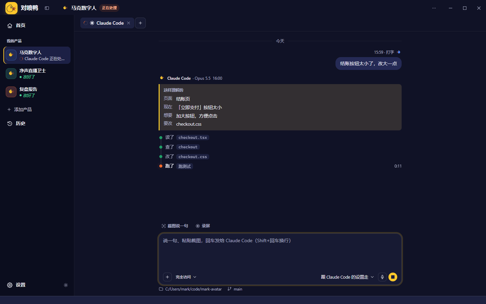
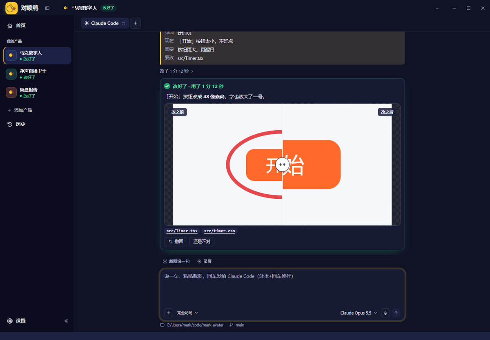

<h1 align="center">对喷鸭 Quack</h1>

<b>在你的产品上指出问题，说一句，AI 直接改掉。</b>

  <a href="https://github.com/Aimark-dai/quack/releases/latest"><b>⬇ 下载 Windows 版</b></a>

---

用 Claude Code、Codex 做产品，最费时间的往往不是改，而是**说清楚哪里要改**：截图、存文件、切窗口、打一大段字解释「哪个页面、哪个按钮、现在什么样、想要什么样」。

对喷鸭把这一步变成一个快捷键：**看到哪里不对，截个图，说一句，回车。** 它交给这个产品的 AI 去改，改完给你看改之前和改之后；不满意，一键撤回。

对喷鸭不是写代码的编辑器，也不卖 AI 额度。它站在**你的产品**这一边，用的是**你自己的** Claude Code / Codex。网页、桌面软件，屏幕上看得到就能指。

## 三种指法

| | 怎么用 | 适合 |
|---|---|---|
| **截图说一句** | `Alt + Shift + A`，框出来，直接在图上画圈，说一句 | 一个具体的问题 |
| **录屏讲一遍** | `Alt + Shift + R`，一边点一边说，需要时用画笔圈出来 | 一次好几个问题、要演示操作的问题 |
| **说话打字** | 在任何输入框里按住 `右 Alt` 说，松开就打出来 | 懒得打字的时候 |

在 VS Code、Cursor 这类编辑器里，对喷鸭会自动把快捷键让给编辑器。

## 看得见 AI 在干嘛

AI 干活时，聊天里有一条实时进度线：读了哪个文件、改了什么、跑了什么。改好了是一张卡片：用了多久、改了几个文件几行。

## 改之前、改之后，一拖就看出来

改好以后，你圈问题的那张图和 AI 改完截的图叠在一起，鼠标左右一拖就看出差别。不对就点「还是不对」接着说，或者「撤回」回到改之前。

## 灵动岛

屏幕顶上一条小胶囊，不用切回对喷鸭也知道 AI 在干嘛：正在处理哪个文件、改好了、在等你回答。

## 亮色、暗色

跟着系统自动切换，侧栏左下角一点就换。

## 开始使用

1. **先装好 Claude Code 或 Codex 命令行，并登录一次。**
   - Claude Code：在 PowerShell 里运行 `irm https://claude.ai/install.ps1 | iex`，然后运行 `claude` 按提示登录
   - Codex：按 OpenAI 官方说明安装后运行 `codex` 登录
2. [下载对喷鸭](https://github.com/Aimark-dai/quack/releases/latest)（`Quack_版本号_x64-setup.exe`），双击安装。
3. 第一次打开跟着三步走：认识鸭子 → 选一个产品的代码文件夹 → 真按一次 `Alt + Shift + A`。
4. 打开你的产品，看到不顺眼的地方，按 `Alt + Shift + A`。

装好以后，对喷鸭会自己检查新版本，不用再来这里下载。

## 常见问题

**要花钱吗？** 对喷鸭本身免费。改代码用的是你自己的 Claude Code / Codex 额度。

**我的代码和截图会传到哪里？** 对喷鸭不上传你的东西：截图、录音、说话识别都在你电脑上处理；问题只交给你自己电脑上的 Claude Code / Codex。之后 Claude Code / Codex 会把截图和问题发给各自的 AI 服务（Anthropic / OpenAI）去处理，和你平时直接用它们一样。

**对喷鸭会改我的 Claude Code / Codex 设置吗？** 默认不会。只有你在「设置 → AI 助手」里打开「让对喷鸭知道你开着的 AI」，对喷鸭才会在 `~/.claude/settings.json` 和 `~/.codex/hooks.json` 里加几条自己的钩子（先备份，原来的设置一条不动）；关掉或卸载就会删掉。

**支持哪些系统？** 目前只有 Windows 10 / 11。

**撤回靠什么？** 靠 git 记录；产品文件夹是 git 仓库时撤回最准。

**AI 没反应？** 在 PowerShell 里运行一次 `claude`（或 `codex`），确认已登录，再回对喷鸭重新发。

---

对喷鸭目前是测试版，欢迎试用和反馈：遇到问题截个图，发微信 aimarkdai（备注「对喷鸭」）。这个仓库只放安装包，用于下载和自动更新。 Copyright © 2026 代赫（Mark）。保留所有权利。免费使用。
